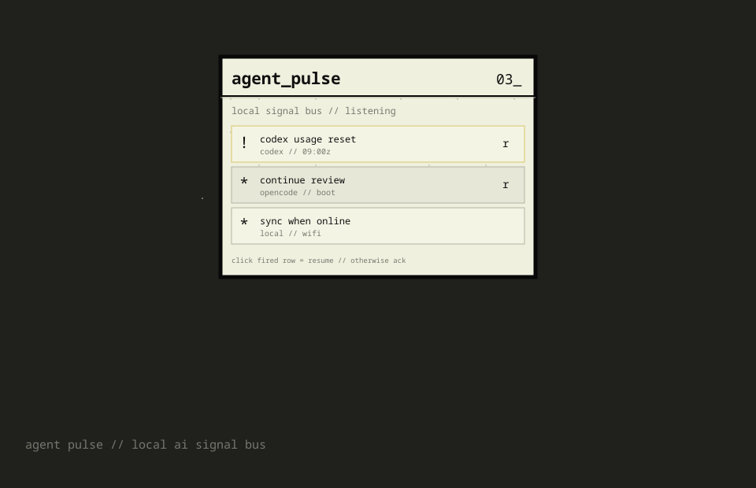

# agent pulse



agent pulse is a compact kde plasma 6 widget and local alert daemon for ai
agents running on the machine. it is vendor-neutral: any process that can
execute a command can create an alert through `agent-alertctl`.

it supports:

- durable time reminders and usage-reset alerts;
- boot and wi-fi-connected triggers;
- desktop notifications through `notify-send`;
- explicit **resume** and **new session** actions;
- per-alert command templates for codex, opencode, claude, local agents, or
  any other session runner;
- a unix socket api at `$XDG_RUNTIME_DIR/agent-alertd.sock`;
- a monochrome, dithered, original-macintosh-inspired plasma surface with
  subtle scanline, cursor, and shimmer effects.

the daemon stores state at `~/.local/state/agent-pulse/alerts.json`. it does
not store credentials, prompt contents, or model transcripts.

## create an alert

```sh
agent-alertctl add \
  --title "codex usage reset" \
  --message "the limit should be available again" \
  --when "2026-11-14t09:00:00-05:00" \
  --agent codex \
  --resume-command 'codex resume --last' \
  --new-command 'codex'
```

for a next-boot reminder:

```sh
agent-alertctl add --title "continue review" --message "resume the pdf bounty" \
  --on boot --agent codex --resume-command 'codex resume --last'
```

agents can use relative durations when the exact reset time is unknown:

```sh
agent-alertctl add --title "retry after quota window" \
  --message "try the suspended task again" --after 90m \
  --agent codex --resume-command 'codex resume --last'
```

the intended policy is agent-driven: an agent should create an alert when it
knows work cannot continue until a future condition, when a usage window is
expected to reset, or when the user needs to be notified after a reboot or
network return. the widget is the monitor and control surface; agents are the
owners of alert intent.

the command fields are tokenized with `shlex`, not passed through a shell.
supported substitutions are `{alert_id}`, `{title}`, `{message}`, and
`{agent}`. commands execute as the local user who owns the daemon.

## install

```sh
./install.sh
systemctl --user daemon-reload
systemctl --user enable --now agent-alertd.service
```

the service is intentionally explicit because it is a persistent user-level
background process.

## validate

```sh
python3 -m unittest discover -s tests -v
python3 -m py_compile scripts/*.py
plasmawindowed --smoke-test org.scorn.agentpulse
```

## api

the cli is the supported api. the daemon also accepts one json object per line
over the unix socket. commands are `add`, `list`, `ack`, `dismiss`, `resume`,
`new`, and `status`; run `agent-alertctl --help` for the exact fields.

## license

mit
